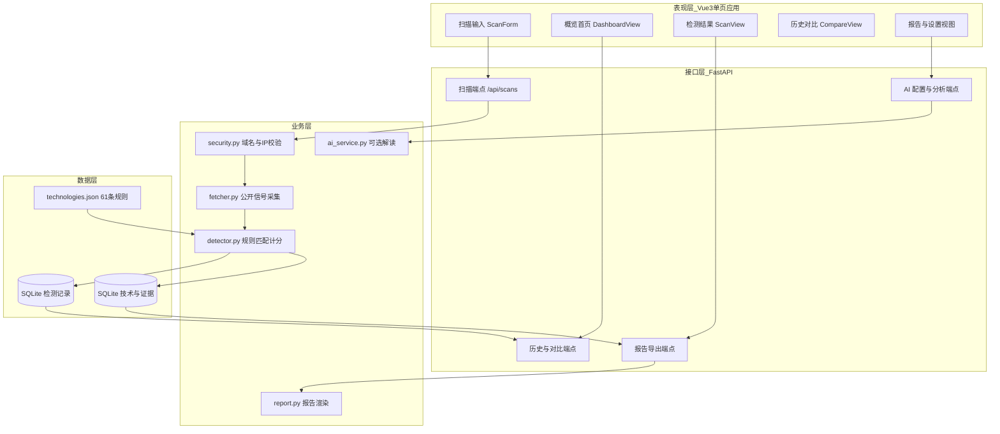
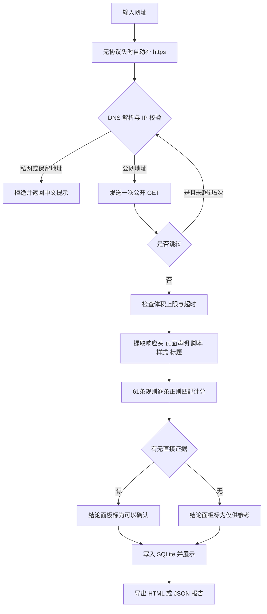
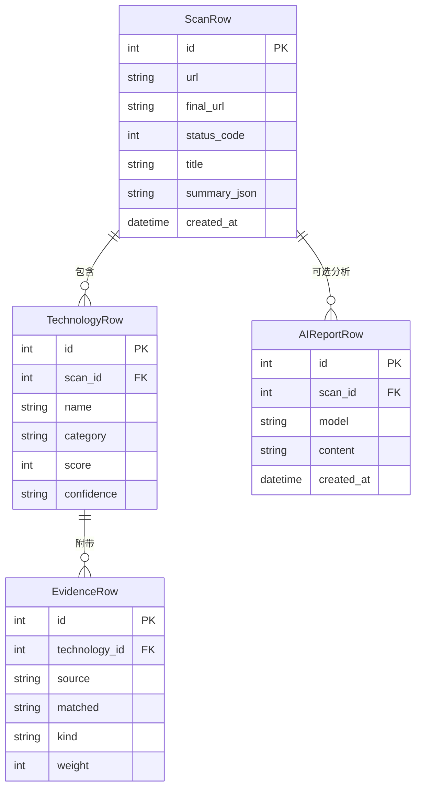
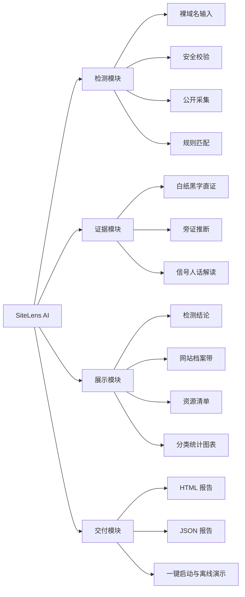

# 系统图纸（校正版备用） [实测 Measured]

> 图纸属于实物设计与制作类的必交材料。本次任务书选的是实践操作类，本文件仅作备用。
> 全部图按当前仓库真实模块绘制。原方案图纸里的「个人标识横幅」并不存在于界面，已删去。

图纸使用 Mermaid 语法。可粘贴到 Typora、VS Code 的 Mermaid 插件或 mermaid.live 导出 PNG。

## 图纸 1 系统总体架构图

## 图纸 2 检测与安全校验工作流程图

采集器禁用环境代理，响应体上限 5 MiB，超时 30 秒。跳转时每一跳都重新校验 IP。

## 图纸 3 数据库实体关系图

`summary_json` 保存响应头、页面声明、脚本、样式、耗时与页面大小。页面 HTML 正文不落库。

## 图纸 4 功能模块结构图

## 图的核对依据 [实测 Measured]

模块名与端点名取自 `backend/app` 与 `frontend/src`。规则数 61 条取自 `technologies.json`。安全参数取自 `security.py`。数据实体取自 `models.py`。界面模块取自 `ScanView.vue` 与 `DashboardView.vue`。

图纸属于备用材料。实践操作类提交时以 `TECHNICAL_SUMMARY.md` 与 `DEFENSE_VIDEO_SCRIPT.md` 为准。
